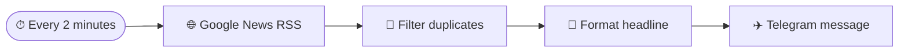

<div align="center">


# ⚡ AI PULSE

### Your Personal AI News Radar

**Fresh AI headlines. Zero noise. Straight to your Telegram.**

[](https://n8n.io/)
[](https://news.google.com/)
[](https://telegram.org/)
[](LICENSE)

**An import-ready n8n automation that watches Google News for AI developments and delivers new headlines to your Telegram chat.**

</div>

---

## ✨ What it does

AI moves fast. AI Pulse keeps an eye on the headlines so you don't have to.

- 🕑 **Checks every 2 minutes** using an n8n Schedule Trigger.
- 🌐 **Reads Google News RSS** for Artificial Intelligence, Generative AI and LLM updates.
- 🧹 **Filters previously sent links** to reduce repeat notifications.
- 📩 **Sends new headlines to Telegram** with the article link and publication date when available.
- 🔐 **Keeps credentials in n8n** — no bot token is stored in this repository.

> **Note:** Google News RSS is a public feed. Feed availability, publication timing and article access are controlled by Google and publishers.

## 🧠 Workflow at a glance



## 📸 Telegram message preview

```text
🤖 AI PULSE — Latest AI News

📰 [Latest AI headline]

🕒 [Publication date, when available]

🔗 [Read the full article]

Your personal AI news radar
```

## 🚀 Quick start

### 1. Requirements

- A running n8n instance (self-hosted or n8n Cloud).
- A Telegram account.
- A Telegram bot created using **@BotFather**.
- Your Telegram chat ID.

### 2. Create your Telegram bot

1. Open Telegram and search for `@BotFather`.
2. Send `/newbot` and follow the prompts.
3. Copy the bot token.
4. Open your new bot and press **Start**.
5. Obtain your chat ID using a trusted Telegram bot/API method.

**Security:** Never commit your Telegram bot token, chat ID if you consider it private, or n8n credentials to GitHub.

### 3. Import the workflow

1. Download [`workflows/ai-pulse-google-news-telegram.json`](workflows/ai-pulse-google-news-telegram.json).
2. In n8n, choose **Workflows → Import from File**.
3. Select the downloaded JSON file.
4. Open the **Deliver to Telegram** node.
5. Create/select Telegram credentials and enter your bot token in n8n's credential form.
6. Replace `YOUR_TELEGRAM_CHAT_ID` with your Telegram chat ID.
7. Save the workflow.

### 4. Test and activate

1. Run the workflow manually once.
2. Confirm that a Telegram message arrives.
3. Check the execution log if a node fails.
4. Activate the workflow.

Your n8n instance must remain running for scheduled executions. For a local installation, the computer must be powered on and connected to the internet.

## ⚙️ Customize the feed

The RSS URL is configured in **Fetch Latest AI Headlines**. You can adjust the search terms, language and region.

Current query covers:
- Artificial Intelligence
- Generative AI
- Large Language Models (LLMs)

The workflow sends up to **5 new items per check**. Duplicate tracking uses n8n workflow static data; test in production mode after activation because static data is persisted by n8n during successful production executions.

## 🗂️ Repository structure

```text
ai-pulse/
├── workflows/
│   └── ai-pulse-google-news-telegram.json
├── docs/
│   └── ARCHITECTURE.md
├── .gitignore
├── CONTRIBUTING.md
├── LICENSE
└── README.md
```

## 🛡️ Privacy & security

- Bot credentials belong in n8n Credentials, never in workflow exports committed to Git.
- Review the Google News feed and publisher links before relying on any headline.
- This project forwards headlines and links; it does not reproduce full copyrighted articles.
- Use responsibly and follow Telegram, Google News and publisher terms.

## 🧭 Roadmap

- [ ] Add topic filters (OpenAI, Google, Anthropic, NVIDIA, robotics).
- [ ] Add optional daily AI news digest.
- [ ] Add AI-generated one-line summaries.
- [ ] Add source and keyword filters.
- [ ] Add configurable quiet hours.
- [ ] Add persistent deduplication using an n8n Data Table or database.

## 🤝 Contributing

Ideas, fixes and improvements are welcome. See [CONTRIBUTING.md](CONTRIBUTING.md).

## 📄 License

Released under the [MIT License](LICENSE).

---

<div align="center">

**Built to make staying current with AI effortless.** ⚡

If this project helps you, consider giving the repository a ⭐

</div>
