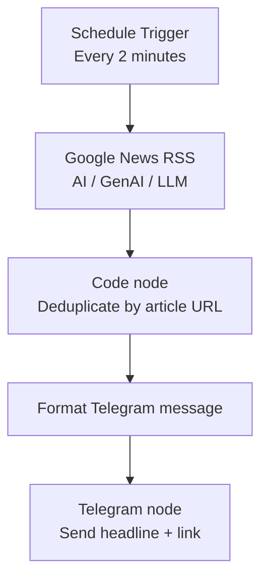

# Architecture

## Components

| Component | Responsibility |
|---|---|
| Schedule Trigger | Starts the workflow every two minutes |
| RSS Feed Read | Retrieves the latest Google News RSS items |
| Code | Tracks previously seen article links and formats fresh items |
| Telegram | Delivers each new item to the configured chat |

## Operational notes

- The workflow sends at most five unseen items on each execution.
- Duplicate tracking uses workflow static data.
- n8n must be running for the schedule to fire.
- Configure the Telegram credential inside n8n; do not store secrets in this repository.
